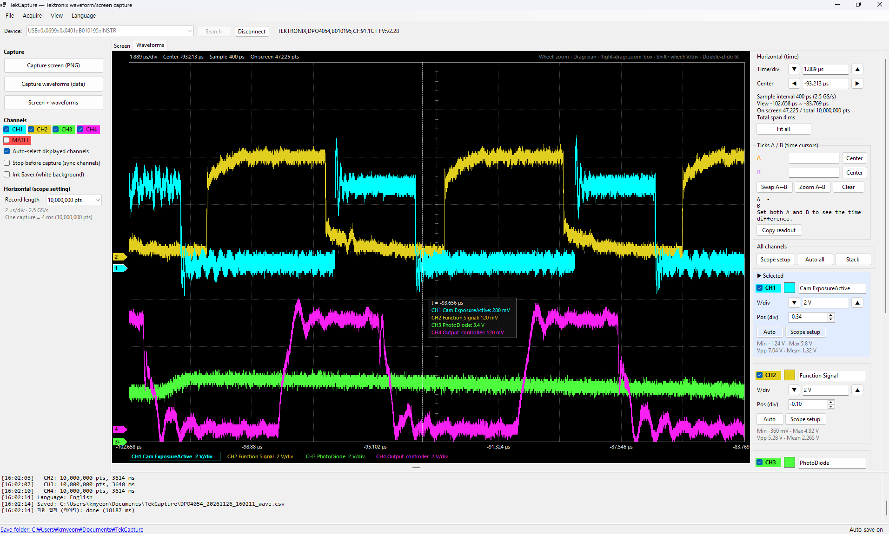

# Tektronix Oscilloscope Tools

[English](README.md) | **한국어**

Tektronix DPO4054 (DPO/MSO4000 계열) 오실로스코프를 USB(VISA)로 다루는 Windows 도구 모음이다.

| 프로그램 | 하는 일 |
|---|---|
| **TekCapture** (`src/TekCapture`) | 화면·파형 캡처, 파형 뷰어, 틱 A/B 측정, CSV 저장·불러오기. OpenChoice Desktop 대체용 |
| **TekMcp** (`src/TekMcp`) | Claude 같은 MCP 클라이언트가 스코프 파형을 직접 캡처하고 분석하게 해 주는 MCP 서버 |



*TekCapture 파형 탭: 10M 포인트 4채널 캡처를 확대한 화면. 마우스 위치의 채널별 값, 오른쪽의 시간축·틱·채널 설정 패널이 보인다.*

# TekCapture

Tektronix DPO4054 (DPO/MSO4000 계열) USB 화면·파형 캡처 프로그램. OpenChoice Desktop 대체용.

## 왜 OpenChoice Desktop이 장치를 못 찾나
이 PC에는 Keysight IO Libraries 2017과 TekVISA가 함께 설치돼 있다.
- `C:\Windows\SysWOW64\visa32.dll`(32비트 VISA)이 Keysight 것이다. OpenChoice Desktop은 32비트 프로그램이라 이 DLL을 쓴다.
- 스코프(USB VID 0x0699 / PID 0x0401)는 TekVISA 드라이버가 아니라 IVI/Keysight USBTMC 드라이버에 잡혀 있다.

64비트 VISA(`visa64.dll`)로는 정상 통신된다. TekCapture는 이 경로를 쓰므로 OpenChoice를 고칠 필요가 없다.

## 빌드 / 실행
```
cd src\TekCapture
dotnet build -c Release
bin\Release\net10.0-windows\TekCapture.exe
```
.NET 10 Desktop Runtime이 필요하다. 다른 PC에 배포하려면:
```
dotnet publish -c Release -r win-x64 --self-contained -p:PublishSingleFile=true -o publish
```

## 기능
- 화면 캡처: PNG, Ink Saver(흰 배경) 옵션 (`HARDCopy STARt`)
- 파형 캡처: CH1–4, MATH. 16비트로 전체 레코드를 받아 전압·시간 단위로 변환하고 CSV로 저장
- 파형 뷰어 (스코프와 같은 10×8 div 화면)
  - 시간축: Time/div(1-2-5 단계 버튼, 직접 입력), 중심 시간, 스크롤바
  - 마우스: 휠로 확대/축소(커서 위치 기준), 드래그로 이동, 우클릭 드래그로 구간 확대, 더블클릭으로 전체 보기
  - 채널별 V/div와 위치(div), 표시 켜기/끄기, 자동, 스코프 설정, 분리 배치
  - 왼쪽 채널 마커를 드래그해 위치 조절. 선택 채널은 Shift+휠로 V/div, Ctrl+휠이나 ↑↓로 위치 조절
  - 마우스 위치의 시간과 각 채널 값 표시. 많이 확대하면 샘플 점이 보임
- 채널 라벨: 처음에는 스코프의 `CHx:LABel` 값을 쓰고, 앱에서 고친 값은 채널별로 기억한다. 그래프, 값 표시, CSV 헤더에 모두 나온다.
- 파형 불러오기: 저장한 CSV를 **파일 → 파형 CSV 열기**로 열거나 창에 끌어다 놓으면 된다. 채널, 라벨, 단위를 헤더에서 되살린다. 시간 열을 공유하는 형식과 채널별 시간/값 쌍 형식을 모두 읽는다. 스코프 V/div 정보는 CSV에 없으므로 처음에는 자동 스케일로 연다.
- 틱 A / B (시간 커서): 파형 뷰어에서 두 시점을 찍어 Δt, 1/Δt, 채널별 A·B 시점 값과 ΔV, A–B 구간의 최소/최대/Vpp/평균, 기울기를 본다.
  - `A` / `B` 키: 마우스 위치에 틱 설정 (화면 밖이면 중심). Ctrl+클릭 = A, Ctrl+우클릭 = B
  - Shift를 함께 누르면 선택 채널의 가장 가까운 엣지(50 % 레벨)에 맞춤
  - 틱 선을 드래그해 이동, Esc로 지움. 오른쪽 패널에서 시간을 직접 입력, A↔B 교환, A–B 확대, 측정값 복사
  - 마우스 위치 값 표시에 `t − A`가 함께 나온다
  - 틱은 `%APPDATA%\TekCapture\ticks.json`에 저장돼 TekMcp의 `measure_ticks`가 읽는다
- 파형 색상: 채널 박스의 색 버튼(라벨 입력칸 왼쪽)이나 **보기 → 채널 색상**에서 바꾼다. 색 버튼을 우클릭하면 기본색으로 돌아간다. 색은 채널별로 `settings.json`의 `Colors`에 저장되고, 이후 캡처, CSV 불러오기, TekMcp 그래프에도 같은 색이 쓰인다.
- 레코드 길이(1k~10M) 설정. 바꿀 때 현재 time/div를 유지하려고 시도한다.
- 메뉴
  - **파일**: 파형 CSV 열기 (Ctrl+O), 파형 CSV 저장 (Ctrl+S), 화면 PNG 저장 (Ctrl+Shift+S), 각각 다른 이름으로 저장, 캡처 시 자동 저장, 저장 폴더 변경/열기
  - **수집**: Run (F5), Stop (F6), Single (F7), 화면 캡처 (F8), 파형 캡처 (F9), 화면+파형 (Ctrl+F9)
  - **보기**: 채널 색상, 화면 탭 (Ctrl+1), 파형 탭 (Ctrl+2)
  - **Language** (보기 메뉴 오른쪽): 한국어 / English. 현재 언어에 체크 표시. 바로 바뀌고 다음 실행 때도 유지된다 (`settings.json`의 `Language`). 처음 실행할 때는 Windows 표시 언어를 따른다. TekMcp의 분석 보고서는 언어 설정과 관계없이 한국어다.
- 저장 위치 기본값: `문서\TekCapture\<모델>_<날짜_시간>_screen.png / _wave.csv`. 현재 폴더는 아래 상태 표시줄에 나오고, 누르면 폴더가 열린다.

## 헤드리스 셀프테스트
```
TekCapture.exe --selftest <출력폴더>
```
`selftest.log`, `screen.png`, `wave.csv`를 만든다.

```
TekCapture.exe --uitest <csv> <출력폴더> [ko|en]
```
스코프에 연결하지 않고 CSV를 띄워 창 전체를 `main_<언어>.png`로, 메뉴 구성을 `menu_<언어>.txt`로 저장한다. 설정 파일은 건드리지 않는다.

---

# TekMcp — 오실로스코프 MCP 서버

Claude 같은 MCP 클라이언트가 스코프 화면과 파형을 직접 읽고 분석하게 해 주는 stdio MCP 서버다 (`src/TekMcp`). TekCapture와 VISA·파형·CSV 코드를 공유하고, TekCapture가 연결돼 있어도 같이 쓸 수 있다. 호출할 때마다 VISA 세션을 열고 닫는다.

## 빌드 / 등록
```
cd src\TekMcp
dotnet build -c Release
```
저장소 루트의 `.mcp.json`에 `tekscope` 서버로 등록돼 있다. 이 폴더에서 Claude Code를 다시 시작하고 서버 사용을 승인하면 된다. 다른 위치에서 쓰려면 다음처럼 등록한다.
```
claude mcp add tekscope -- dotnet C:\...\RemoteTekVisa\src\TekMcp\bin\Release\net10.0-windows\TekMcp.dll
```
스코프는 USB VID 0x0699 장치를 자동으로 찾는다. 다른 장치를 쓰려면 환경 변수 `TEK_RESOURCE`나 도구의 `resource` 인자로 지정한다.

## 라벨(신호 이름) 흐름
1. TekCapture 파형 탭에서 채널 라벨을 붙인다 (예: CH1 = `VIN`, CH2 = `SW`). 라벨은 바로 `%APPDATA%\TekCapture\settings.json`에 저장된다.
2. MCP 서버는 캡처할 때마다 이 파일을 읽어 라벨을 붙인다. 우선순위는 이번 세션의 `set_channel_labels` → TekCapture 앱 라벨 → 스코프 `CHx:LABel` 순이다. CSV를 불러올 때는 CSV 헤더의 라벨을 쓴다.
3. 보고서·그래프·채널 지정 인자는 모두 라벨 이름을 쓴다 (`channels: ["VIN","SW"]`, `get_waveform_samples(channel: "VIN")`). 서버 instructions와 `analyze_waveforms` 프롬프트는 분석할 때 신호를 라벨 이름으로 부르도록 지시한다.
4. 반대로 Claude에서 `set_channel_labels`를 쓰면 앱 설정과 스코프 화면 라벨(영문만 가능)에도 기록된다. TekCapture 창은 다시 활성화될 때 바뀐 라벨을 읽는다.

## 도구
| 도구 | 하는 일 |
|---|---|
| `scope_info` | 연결 상태, 표시 채널, 라벨과 출처, 수평·트리거·획득·채널 설정 |
| `capture_screen` | 스코프 화면 PNG를 이미지로 돌려줌 (화면의 측정값·커서를 읽을 때). 채널별 라벨 목록을 함께 줌 |
| `capture_waveforms` | 파형 데이터 캡처 → 분석 보고서와 그래프 이미지. RUN 중이면 잠시 Stop해 채널을 같은 획득에서 읽고 다시 Run. CSV 저장 |
| `load_waveform_csv` | 저장된 CSV 분석 (경로를 비우면 가장 최근 파일) |
| `list_captures` | 저장 폴더의 PNG/CSV 목록과 CSV 헤더(라벨) |
| `set_channel_labels` | 라벨 지정·삭제 |
| `analyze_window` | 현재 파형에서 특정 시간 구간만 다시 분석 |
| `plot_waveforms` | 구간 그래프 (채널별로 나눠 그리기 또는 겹쳐 그리기) |
| `get_waveform_samples` | 한 채널의 구간 샘플을 숫자 표로 줌 (구간이 길면 최소/최대/평균으로 줄임) |
| `measure_ticks` | 틱 A–B 측정: Δt, 1/Δt, 채널별 A·B 값·ΔV·구간 통계, 틱에 가장 가까운 엣지, A–B 사이 엣지 목록, 틱이 표시된 그래프. 인자를 비우면 뷰어의 틱(과 그 CSV)을 쓰고, `"VIN rise"`, `"SW fall 2"`처럼 엣지로도 지정 가능 (B는 A 이후부터 셈). 결과 틱은 같은 CSV를 보는 뷰어에도 표시됨 |
| `acquisition_control` | run / stop / single |

프롬프트 `analyze_waveforms(source: live|file, context)`는 캡처하고, 라벨 이름 기준으로 신호별 특성 → 신호 간 관계 → 이상 징후 → 결론 순으로 종합 분석하게 한다.

## 자동 분석 내용
- 신호 종류 판별: 유효 신호 없음(ADC 몇 단계 노이즈), DC(리플 포함), 디지털 펄스열, 상태 전환(스텝), 아날로그 주기, 비주기
- 채널별: 평균/최소/최대/Vpp/RMS, High/Low 레벨(히스토그램 기준), 주파수·주기 지터(중앙값 기준이라 글리치에 흔들리지 않음), 듀티, 펄스 폭, 10–90 % 상승·하강시간, 오버슈트, 레벨 노이즈, DC 리플
- 이상 검사: 추가 펄스(글리치), 누락 펄스, 상·하단 클리핑, 수직 해상도 부족, 샘플레이트 부족, 트리거 레벨이 신호 범위를 벗어난 경우
- 채널 간: 상관계수(동상/역상), 주파수 비(정수배면 분주 관계로 표시), 상승 엣지 지연과 위상, 상보 신호의 데드타임과 겹침(슛스루 위험), 단발 엣지의 시간순 이벤트 목록

## 셀프테스트 (MCP 클라이언트 없이)
```
TekMcp.exe --selftest <출력폴더> [synthetic | live | <csv 경로>]
```
`report.md`, `plot.png`, `plot_zoom_overlay.png`를 만든다. `synthetic`은 데드타임이 있는 상보 PWM, 글리치, 리플이 있는 레일, 인에이블 스텝으로 이루어진 합성 신호다.
