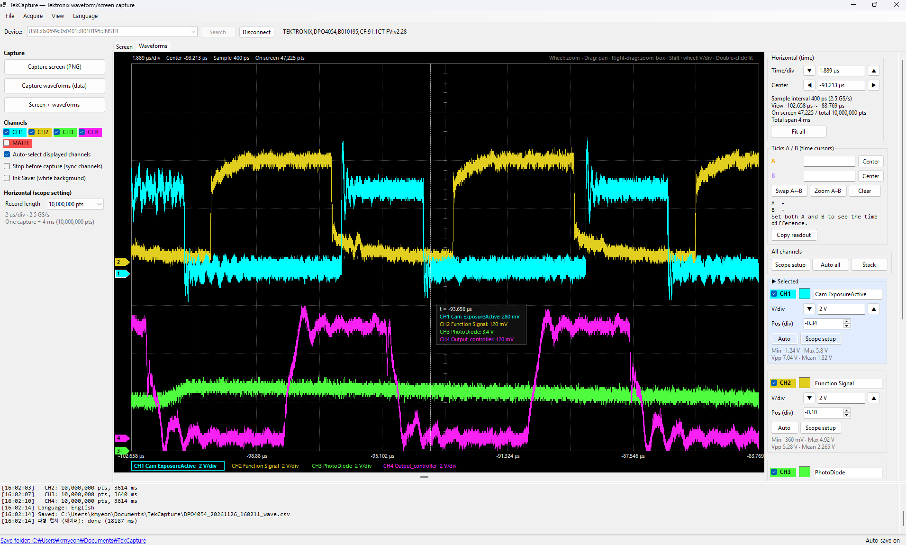

# Tektronix Oscilloscope Tools

**English** | [한국어](README.ko.md)

Windows tools for driving a Tektronix DPO4054 (DPO/MSO4000 series) oscilloscope over USB (VISA).

| Program | What it does |
|---|---|
| **TekCapture** (`src/TekCapture`) | Screen and waveform capture, waveform viewer, tick A/B measurements, CSV save/load. A replacement for OpenChoice Desktop |
| **TekMcp** (`src/TekMcp`) | MCP server that lets an MCP client such as Claude capture and analyze scope waveforms directly |



*TekCapture waveform tab: zoomed into a 4-channel, 10M-point capture. It shows per-channel values at the mouse position, with the time base, tick and channel panels on the right.*

# TekCapture

USB screen and waveform capture for the Tektronix DPO4054 (DPO/MSO4000 series). A replacement for OpenChoice Desktop.

## Why OpenChoice Desktop could not find the scope
This PC has both Keysight IO Libraries 2017 and TekVISA installed.
- `C:\Windows\SysWOW64\visa32.dll` (32-bit VISA) belongs to Keysight. OpenChoice Desktop is a 32-bit program, so it loads this DLL.
- The scope (USB VID 0x0699 / PID 0x0401) is bound to the IVI/Keysight USBTMC driver, not the TekVISA driver.

Communication works fine through the 64-bit VISA (`visa64.dll`). TekCapture uses that path, so OpenChoice does not need fixing.

## Build / run
```
cd src\TekCapture
dotnet build -c Release
bin\Release\net10.0-windows\TekCapture.exe
```
Requires the .NET 10 Desktop Runtime. To deploy to another PC:
```
dotnet publish -c Release -r win-x64 --self-contained -p:PublishSingleFile=true -o publish
```

## Features
- Screen capture: PNG, with an optional Ink Saver (white background) mode (`HARDCopy STARt`)
- Waveform capture: CH1–4 and MATH. Reads the full record as 16-bit data, converts it to volts and seconds, and saves it as CSV
- Waveform viewer (same 10×8 div graticule as the scope)
  - Time base: Time/div (1-2-5 step buttons or direct entry), center time, scroll bar
  - Mouse: wheel to zoom around the cursor, drag to pan, right-drag to zoom into a box, double-click to fit all
  - Per-channel V/div and position (div), show/hide, auto, scope setup, stacked layout
  - Drag the channel markers on the left to move a channel. For the selected channel, Shift+wheel changes V/div and Ctrl+wheel or ↑↓ changes position
  - Shows the time and each channel's value at the mouse position. Individual samples appear when zoomed in far enough
- Channel labels: initially taken from the scope's `CHx:LABel`. Labels edited in the app are remembered per channel and appear on the plot, in the value readout and in the CSV header.
- Loading waveforms: open a saved CSV with **File → Open waveform CSV** or drag it onto the window. Channels, labels and units are restored from the header. Both a shared time column and per-channel time/value pairs are supported. CSV files carry no scope V/div information, so they open with auto scaling.
- Ticks A / B (time cursors): mark two points in the viewer to see Δt, 1/Δt, each channel's value at A and B and its ΔV, the min/max/Vpp/mean over A–B, and the slope.
  - `A` / `B` keys: set a tick at the mouse position (the center if the mouse is outside the plot). Ctrl+click = A, Ctrl+right-click = B
  - Hold Shift as well to snap to the nearest edge (50 % level) of the selected channel
  - Drag a tick line to move it; Esc clears the ticks. The right panel lets you type tick times, swap A↔B, zoom to A–B and copy the readout
  - The mouse readout also shows `t − A`
  - Ticks are saved to `%APPDATA%\TekCapture\ticks.json`, which TekMcp's `measure_ticks` reads
- Waveform colors: change them with the color button in each channel box (left of the label field) or from **View → Channel colors**. Right-click a color button to restore the default color. Colors are saved per channel under `Colors` in `settings.json` and are reused for later captures, loaded CSVs and TekMcp plots.
- Record length (1k–10M). Changing it tries to keep the current time/div.
- Menus
  - **File**: Open waveform CSV (Ctrl+O), Save waveform CSV (Ctrl+S), Save screen PNG (Ctrl+Shift+S), Save as… for each, Auto-save on capture, change/open the save folder
  - **Acquire**: Run (F5), Stop (F6), Single (F7), Capture screen (F8), Capture waveforms (F9), Screen + waveforms (Ctrl+F9)
  - **View**: Channel colors, Screen tab (Ctrl+1), Waveform tab (Ctrl+2)
  - **Language** (right of View): 한국어 / English, with a check mark on the current one. The switch is immediate and is kept for the next launch (`Language` in `settings.json`). On first launch the Windows display language is used. TekMcp analysis reports are always in Korean, whatever this setting is.
- Default save location: `Documents\TekCapture\<model>_<date_time>_screen.png / _wave.csv`. The current folder is shown in the status bar at the bottom; click it to open the folder.

## Headless self-tests
```
TekCapture.exe --selftest <output folder>
```
Writes `selftest.log`, `screen.png` and `wave.csv`.

```
TekCapture.exe --uitest <csv> <output folder> [ko|en]
```
Opens the CSV without connecting to a scope, then saves the whole window as `main_<lang>.png` and the menu structure as `menu_<lang>.txt`. It does not touch the settings file.

---

# TekMcp — oscilloscope MCP server

A stdio MCP server (`src/TekMcp`) that lets an MCP client such as Claude read and analyze the scope screen and waveforms directly. It shares the VISA, waveform and CSV code with TekCapture and can be used while TekCapture is connected. It opens and closes a VISA session on every call.

## Build / register
```
cd src\TekMcp
dotnet build -c Release
```
The repository root's `.mcp.json` registers it as the `tekscope` server. Restart Claude Code in this folder and approve the server. To use it from another location, register it like this:
```
claude mcp add tekscope -- dotnet C:\...\RemoteTekVisa\src\TekMcp\bin\Release\net10.0-windows\TekMcp.dll
```
The scope is found automatically as a USB VID 0x0699 device. To use a different instrument, set the `TEK_RESOURCE` environment variable or pass the tool's `resource` argument.

## Label (signal name) flow
1. Label the channels in TekCapture's waveform tab (for example CH1 = `VIN`, CH2 = `SW`). Labels are saved immediately to `%APPDATA%\TekCapture\settings.json`.
2. The MCP server reads this file on every capture to attach labels. Priority: this session's `set_channel_labels` → TekCapture app labels → the scope's `CHx:LABel`. When loading a CSV, the labels in the CSV header are used.
3. Reports, plots and channel arguments all use label names (`channels: ["VIN","SW"]`, `get_waveform_samples(channel: "VIN")`). The server instructions and the `analyze_waveforms` prompt tell the client to refer to signals by label name.
4. In the other direction, `set_channel_labels` from Claude also writes to the app settings and to the scope's on-screen labels (ASCII only). The TekCapture window picks up changed labels when it is activated again.

## Tools
| Tool | What it does |
|---|---|
| `scope_info` | Connection state, displayed channels, labels and their source, horizontal/trigger/acquisition/channel settings |
| `capture_screen` | Returns the scope screen as a PNG image (for reading on-screen measurements and cursors), with the label of each channel |
| `capture_waveforms` | Captures waveform data → analysis report and plot image. If the scope is running, it stops briefly so all channels come from the same acquisition, then runs again. Saves a CSV |
| `load_waveform_csv` | Analyzes a saved CSV (the most recent file if the path is empty) |
| `list_captures` | Lists the PNG/CSV files in the save folder with each CSV's header (labels) |
| `set_channel_labels` | Sets or clears labels |
| `analyze_window` | Re-analyzes only a given time window of the current waveforms |
| `plot_waveforms` | Plots a window (one panel per channel or overlaid) |
| `get_waveform_samples` | Returns one channel's samples in a window as a table (reduced to min/max/mean when the window is long) |
| `measure_ticks` | Tick A–B measurement: Δt, 1/Δt, each channel's A/B values, ΔV and window statistics, the edge nearest each tick, the edges between A and B, and a plot with the ticks. With no arguments it uses the viewer's ticks (and their CSV). Ticks can also be given as edges such as `"VIN rise"` or `"SW fall 2"` (B counts from A onward). The resulting ticks also appear in a viewer showing the same CSV |
| `acquisition_control` | run / stop / single |

The `analyze_waveforms(source: live|file, context)` prompt captures data and asks for a full analysis by label name, in this order: per-signal characteristics → relationships between signals → anomalies → conclusion.

## What the automatic analysis covers
- Signal classification: no valid signal (a few ADC steps of noise), DC (with ripple), digital pulse train, state change (step), periodic analog, aperiodic
- Per channel: mean/min/max/Vpp/RMS, high/low levels (from a histogram), frequency and period jitter (median-based, so glitches do not skew it), duty cycle, pulse width, 10–90 % rise/fall time, overshoot, level noise, DC ripple
- Anomaly checks: extra pulses (glitches), missing pulses, clipping at the top or bottom, insufficient vertical resolution, insufficient sample rate, trigger level outside the signal range
- Between channels: correlation (in phase / inverted), frequency ratio (integer ratios are reported as division), rising-edge delay and phase, dead time and overlap of complementary signals (shoot-through risk), and a time-ordered event list for single-shot edges

## Self-test (without an MCP client)
```
TekMcp.exe --selftest <output folder> [synthetic | live | <csv path>]
```
Writes `report.md`, `plot.png` and `plot_zoom_overlay.png`. `synthetic` is a generated signal set: complementary PWM with dead time, a glitch, a rail with ripple, and an enable step.
